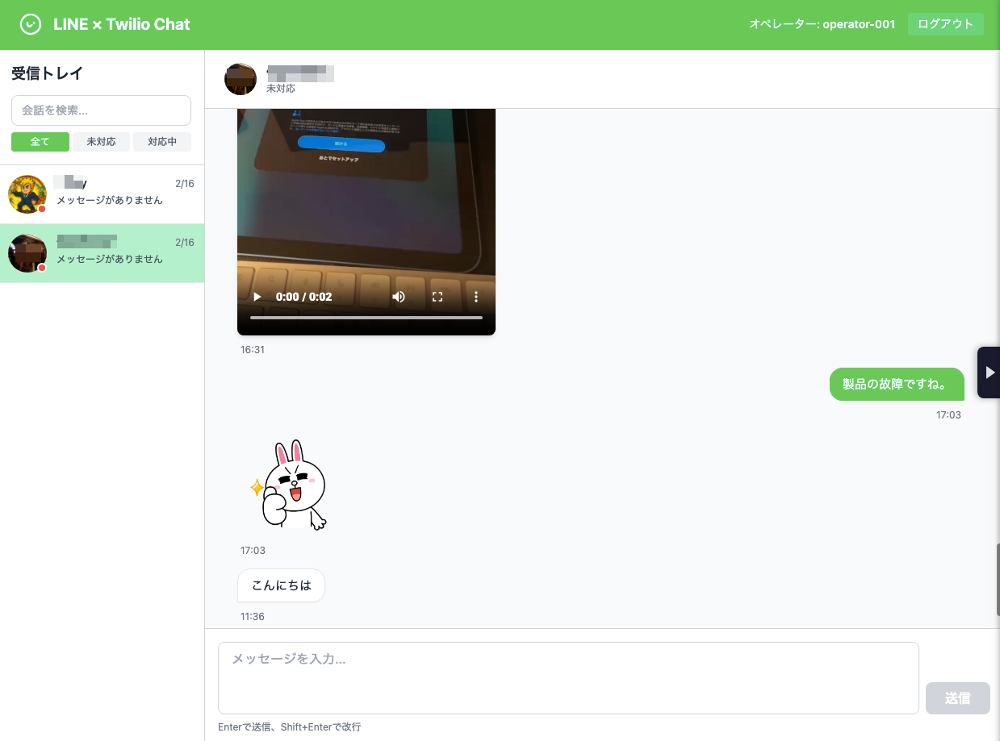

# LINE × Twilio Conversations 統合チャットプラットフォーム

LINE公式アカウントとTwilio Conversations APIを統合し、独自のWeb Chat UIでオペレーターがLINEユーザーとリアルタイムにメッセージのやり取りを行うプラットフォームです。



## 🚀 主な機能

- **双方向メッセージング**: LINEユーザー ↔ オペレーター間でリアルタイムチャット
- **リッチメディア対応**: 画像・動画・スタンプ・絵文字の送受信
- **Web Chat UI**: Next.js + Twilio Conversations SDKによるモダンなUI
- **サーバーレス/コンテナ対応**: Cloudflare Workers または Google Cloud Run
- **TypeScript**: フルスタックTypeScriptで型安全な開発
- **モノレポ構成**: pnpm workspacesで効率的な管理

## 📋 前提条件

- Node.js 20以上
- pnpm 8以上
- Twilioアカウント（Conversations Service設定済み）
- LINE Developersアカウント（チャネル作成済み）
- Cloudflareアカウント（Workers利用可能）またはGoogle Cloud Platform（Cloud Run利用可能）

## 🛠 セットアップ

### 1. リポジトリのクローン

```bash
git clone <repository-url>
cd line-twilio-chat
```

### 2. 依存関係のインストール

```bash
pnpm install
```

### 3. 環境変数の設定

```bash
cd packages/middleware

# .dev.varsファイルを作成
cp .dev.vars.example .dev.vars
# .dev.varsを編集して実際の値を設定

# Cloud Runデプロイ時に環境変数を指定（後述）
```

#### Web UI

```bash
cd packages/web-ui
cp .env.local.example .env.local
# .env.localを編集して以下を設定:
# - NEXT_PUBLIC_MIDDLEWARE_URL (Cloud RunのURL)
# - TWILIO_ACCOUNT_SID
# - TWILIO_API_KEY_SID
# - TWILIO_API_KEY_SECRET
# - TWILIO_CONVERSATIONS_SERVICE_SID
```

### 4. Twilio Conversations Webhookの設定

Twilio Consoleで以下を設定:

1. Conversations Service → Configuration → Webhooks
2. **Post-Event URL**: `https://your-service.run.app/webhook/conversations`
3. **Method**: POST
4. **Events**: `onMessageAdded`

### 5. LINE Webhook URLの設定

LINE Developers Consoleで以下を設定:

1. チャネル設定 → Messaging API設定
2. **Webhook URL**: `https://your-service.run.app/webhook/line`
3. **Webhookの利用**: 有効化

### 6. Google Cloud Runへデプロイ

```bash
# プロジェクトルートから実行

# 1. Artifact Registryリポジトリを作成（初回のみ）
gcloud artifacts repositories create line-twilio-chat \
  --repository-format=docker \
  --location=asia-northeast1

# 2. Docker imageをビルド＆プッシュ
gcloud builds submit --tag asia-northeast1-docker.pkg.dev/YOUR_PROJECT_ID/line-twilio-chat/middleware:latest .

# 3. Cloud Runにデプロイ
gcloud run deploy line-twilio-chat-middleware \
  --image asia-northeast1-docker.pkg.dev/YOUR_PROJECT_ID/line-twilio-chat/middleware:latest \
  --platform managed \
  --region asia-northeast1 \
  --allow-unauthenticated \
  --set-env-vars="LINE_CHANNEL_ACCESS_TOKEN=xxx,LINE_CHANNEL_SECRET=xxx,TWILIO_ACCOUNT_SID=xxx,TWILIO_AUTH_TOKEN=xxx,TWILIO_API_KEY_SID=xxx,TWILIO_API_KEY_SECRET=xxx,TWILIO_CONVERSATIONS_SERVICE_SID=xxx"
```

詳細は `packages/middleware/CLOUDRUN_DEPLOY.md` を参照してください。

#### Web UIのデプロイ

```bash
cd packages/web-ui
pnpm build

# Vercelの場合
vercel deploy

# または他のホスティングサービスへデプロイ
```

## 🧪 開発

### ローカル開発サーバーの起動

```bash
# 全パッケージを同時に起動
pnpm dev

# または個別に起動
pnpm --filter middleware dev    # Node.js版 (localhost:8080)
pnpm --filter web-ui dev        # Next.js (localhost:3000)
```

### 型チェック

```bash
pnpm typecheck
```

### ビルド

```bash
pnpm build
```

## 📁 プロジェクト構成

```
line-twilio-chat/
├── packages/
│   ├── shared/              # 共有型定義・ユーティリティ
│   ├── middleware/          # ミドルウェア (Hono)
│   │   ├── src/
│   │   │   ├── routes/      # APIルート
│   │   │   ├── services/    # LINE/Twilioクライアント
│   │   │   ├── handlers/    # メッセージ変換ハンドラ
│   │   │   ├── index.ts     # メインアプリケーション
│   │   │   └── server.ts    # Node.js HTTPサーバー
│   │   └── Dockerfile       # Cloud Run用
│   └── web-ui/              # Next.js App
│       ├── src/
│       │   ├── app/         # Next.js App Router
│       │   ├── components/  # Reactコンポーネント
│       │   ├── hooks/       # Twilio SDK hooks
│       │   └── lib/         # ユーティリティ
│       └── package.json
├── Dockerfile               # ルートDockerfile（ワークスペース対応）
├── docs/                    # 設計ドキュメント
├── CLAUDE.md               # AI開発用ドキュメント
└── README.md               # このファイル
```

## 🔧 技術スタック

| 層 | 技術 |
|---|---|
| フロントエンド | Next.js 15, React, Tailwind CSS |
| バックエンド | Hono (Node.js) |
| コンテナ | Google Cloud Run, Docker |
| リアルタイム通信 | Twilio Conversations JS SDK |
| メッセージング | LINE Messaging API |
| メディアストレージ | Twilio Media Content Service (MCS) |
| 言語 | TypeScript (strict mode) |
| パッケージ管理 | pnpm workspaces |

## 📊 アーキテクチャ

### メッセージフロー

#### LINE → Web UI
1. LINEユーザーがメッセージ送信（テキスト・画像・動画・スタンプ）
2. LINE → ミドルウェアのWebhook (`/webhook/line`)
3. ミドルウェア:
   - テキスト: そのままTwilio Conversationsに保存
   - 画像/動画: LINEからダウンロード → Twilio MCSにアップロード → メッセージに添付
   - スタンプ: スタンプ情報をattributesに保存
4. Twilio SDK → Web UIにリアルタイム配信 (`messageAdded`イベント)
5. Web UI:
   - 画像/動画: `attachedMedia[].getContentTemporaryUrl()`で署名付きURLを取得して表示
   - スタンプ: LINE CDNから取得して表示

#### Web UI → LINE
1. オペレーターがWeb UIでメッセージ送信
2. Web UI → Twilio Conversations API でメッセージ保存
3. Twilio → ミドルウェアのWebhook (`/webhook/conversations`)
4. ミドルウェア → LINE Messaging API でメッセージ送信

### メディア処理フロー

```
LINE画像/動画
  ↓
[LINE Content API] ← ミドルウェアがダウンロード
  ↓
[Twilio MCS] ← バイナリデータをアップロード
  ↓
[Conversations Message] ← Media SIDを添付
  ↓
[Web UI] ← 署名付き一時URLで表示
```

## 🎨 対応メッセージタイプ

### LINE → Web UI

| タイプ | 対応状況 | 表示方法 |
|---|---|---|
| テキスト | ✅ | そのまま表示 |
| 絵文字 | ✅ | Unicode絵文字として表示 |
| スタンプ | ✅ | LINE CDNから画像取得 |
| 画像 | ✅ | Twilio MCS経由で表示 |
| 動画 | ✅ | Twilio MCS経由で再生 |
| 音声 | ⏳ 未実装 | - |
| 位置情報 | ⏳ 未実装 | - |
| ファイル | ⏳ 未実装 | - |

### Web UI → LINE

| タイプ | 対応状況 |
|---|---|
| テキスト | ✅ |
| その他 | ⏳ 未実装 |

## 🐛 トラブルシューティング

### メッセージが届かない

1. **ミドルウェアのログ確認**:

   ```bash
   gcloud logging read "resource.type=cloud_run_revision AND resource.labels.service_name=line-twilio-chat-middleware" --limit 50
   ```

2. **Webhook設定の確認**:
   - Twilio Conversations Webhook URL
   - LINE Webhook URL

3. **環境変数の確認**:

   ```bash
   gcloud run services describe line-twilio-chat-middleware --region asia-northeast1
   ```

### 画像/動画が表示されない

1. **Twilio MCSへのアップロード確認**:
   ログに`MCS Response status: 201`と`Media SID: MExxxx`が表示されているか確認

2. **Web UIでの署名付きURL取得確認**:
   ブラウザコンソールで`Failed to load image/video URL`エラーがないか確認

3. **一時URLの期限**:
   Twilioの署名付きURLは一定時間で期限切れになります。ページを再読み込みしてください。

4. **ローカル開発環境での確認**:
   `.dev.vars`ファイルが正しく設定されているか確認してください。

### 会話が表示されない

オペレーターがParticipantとして追加されているか確認:

```bash
curl -X GET \
  "https://conversations.twilio.com/v1/Services/{ServiceSid}/Conversations/{ConversationSid}/Participants" \
  -u "{AccountSid}:{AuthToken}"
```

Participantが空の場合、手動で追加:

```bash
curl -X POST \
  "https://conversations.twilio.com/v1/Services/{ServiceSid}/Conversations/{ConversationSid}/Participants" \
  -d "Identity=operator-001" \
  -u "{AccountSid}:{AuthToken}"
```

## 📝 重要な実装ノート

### Twilio Conversations Webhookの形式

Twilioのwebhookは`application/x-www-form-urlencoded`形式で送信されます:

```typescript
// ✅ 正しい
const formData = await c.req.formData();
const event = Object.fromEntries(formData);

// ❌ 間違い
const event = await c.req.json();
```

### Participant自動追加

`getSubscribedConversations()`はParticipantとして追加されている会話のみを返すため、以下の実装が必須:

- 新規Conversation作成時: `addParticipant(conversationSid, 'operator-001')`
- 既存Conversation取得時: 未追加なら`addParticipant()`

### リアルタイム会話検出

以下のイベントをリッスンして新しい会話を検出:

- `conversationAdded`: 新規作成
- `conversationJoined`: Participantとして追加された既存会話

### ES Modules対応

Node.js環境で実行する場合、相対importに`.js`拡張子が必要:

```typescript
// ✅ 正しい
import { LineClient } from '../services/line.js';

// ❌ 間違い
import { LineClient } from '../services/line';
```

## 📄 ライセンス

MIT

## 🤝 コントリビューション

開発に参加する場合は、`CLAUDE.md`と`docs/`配下のドキュメントを必ず確認してください。

## 📞 サポート

Issue や Pull Request をお待ちしています！
